<a id="inicio"></a>

<p align="center">
  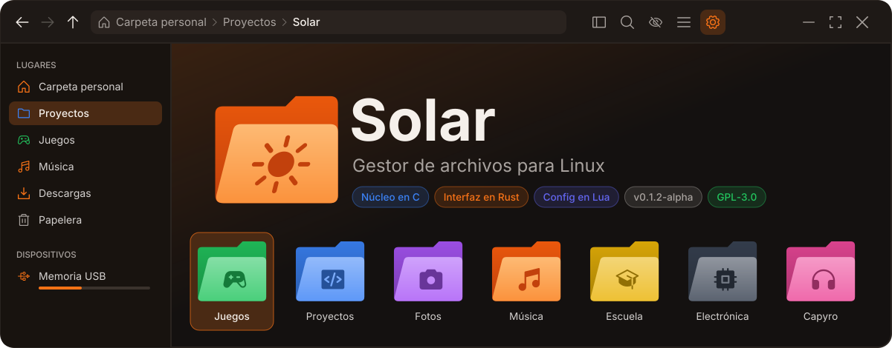
</p>

<p align="center">
  <b>Un gestor de archivos donde cada carpeta tiene su propio color y logotipo.</b><br>
  <sub>Tu carpeta <code>Juegos</code> verde con un mando verde oscuro, <code>Proyectos</code> azul con <code>&lt;/&gt;</code>, <code>Escuela</code> amarilla con un birrete…</sub>
</p>

> [!IMPORTANT]
> **Solar por ahora es exclusivo de Linux.** El núcleo usa cosas propias de
> Linux (inotify, `/proc`, `/sys`, udisks2) y no compila en Windows ni macOS.

<table align="center">
<tr>
<td align="center" width="16.6%"><a href="#que-trae"><br><sub><b>Qué trae</b></sub></a></td>
<td align="center" width="16.6%"><a href="#capturas"><br><sub><b>Capturas</b></sub></a></td>
<td align="center" width="16.6%"><a href="#instalar"><br><sub><b>Instalar</b></sub></a></td>
<td align="center" width="16.6%"><a href="#uso"><br><sub><b>Uso rápido</b></sub></a></td>
<td align="center" width="16.6%"><a href="#configuracion"><br><sub><b>Configuración</b></sub></a></td>
<td align="center" width="16.6%"><a href="#temas"><br><sub><b>Temas</b></sub></a></td>
</tr>
<tr>
<td align="center" width="16.6%"><a href="#actualizar"><br><sub><b>Actualizar</b></sub></a></td>
<td align="center" width="16.6%"><a href="#desinstalar"><br><sub><b>Desinstalar</b></sub></a></td>
<td align="center" width="16.6%"><a href="#como-esta-hecho"><br><sub><b>Cómo está hecho</b></sub></a></td>
<td align="center" width="16.6%"><a href="#pruebas"><br><sub><b>Pruebas</b></sub></a></td>
<td align="center" width="16.6%"><a href="#licencia"><br><sub><b>Licencia</b></sub></a></td>
<td align="center" width="16.6%"><a href="#creditos"><br><sub><b>Créditos</b></sub></a></td>
</tr>
</table>

<p align="center"><sub>12 carpetas · haz clic en una para abrirla</sub></p>


<a id="que-trae"></a>

##  Qué trae

<sub>⌂ Solar › <b>Qué trae</b></sub>

**Carpetas a tu gusto**

- Clic derecho → **Color de carpeta**: 21 colores listos, o el tuyo con
  selector y código hex.
- Clic derecho → **Logotipo**: 54 (mando, música, código, cámara, chip,
  cohete, sol…) o un texto/emoji, con su propio color.
- Todas las carpetas se dibujan con la forma del logo de Solar. El estilo
  sigue a la carpeta si la renombras o la mueves, y viaja con las copias.

**Se ve como tú quieras**

- **9 temas** con nombres de astros: Sol, Aurora, Eclipse, Nebulosa, Venus,
  Neptuno, Marte, Mercurio y Luna, y los tuyos en Lua.
- **Fondo transparente** con opacidad, tamaño de la interfaz y fuente.
- Barra de ubicación **arriba o abajo**, barra lateral **izquierda o derecha**.
- **Animaciones** suaves y **efectos de sonido** (los de Capyro). Las dos se
  pueden apagar.

**Hace lo que esperas de un gestor de archivos**

- Cuadrícula y lista, orden natural (la ñ va después de la n), ocultos,
  búsqueda al escribir, selección con banda y teclado.
- Copiar, mover y pegar con progreso y conflictos; **papelera** compatible
  con la de tu escritorio; arrastrar y soltar.
- **Memorias USB** en la barra lateral: montar con un clic y expulsar seguro.
- **Abrir con** los programas que tienes (Neovim, VSCodium, VS Code,
  Mousepad…), con su ícono, incluidos los de Flatpak.
- **Atajos de teclado** configurables, **Lugares** editables y la carpeta se
  actualiza sola cuando algo cambia.
- **Se actualiza desde GitHub** sin desinstalar, y su logo sale en la barra
  de tareas (también en Wayland).

<p align="right"><sub><a href="#inicio">↑ Subir</a></sub></p>


<a id="capturas"></a>

##  Capturas

<sub>⌂ Solar › <b>Capturas</b></sub>

**En un escritorio de verdad:** Gentoo con Niri, fondo transparente,
carpetas con color y logotipo, una SSD en *Dispositivos* y el logo en el dock.

<p align="center">
  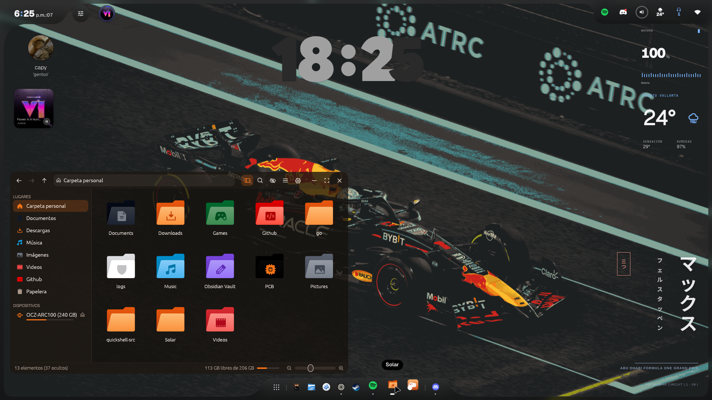
</p>

<p align="center">
  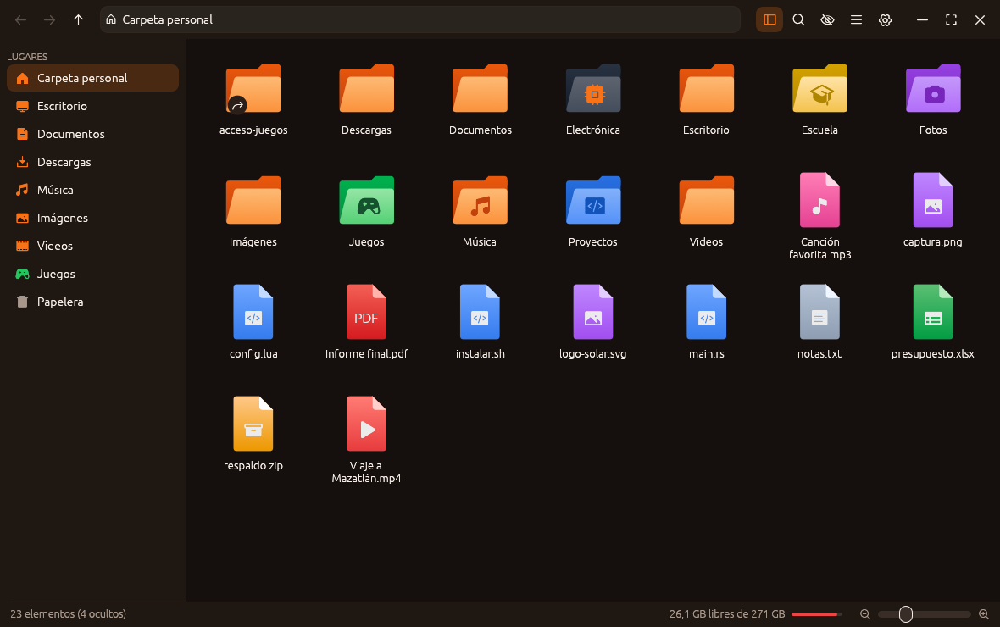
</p>

<table>
<tr>
<td width="50%">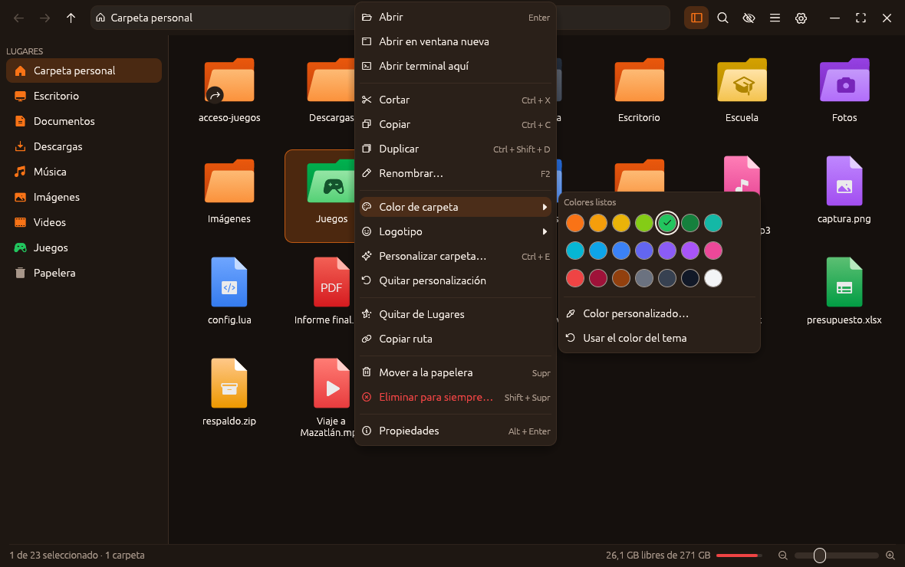<p align="center"><sub>Clic derecho → <b>Color de carpeta</b></sub></p></td>
<td width="50%">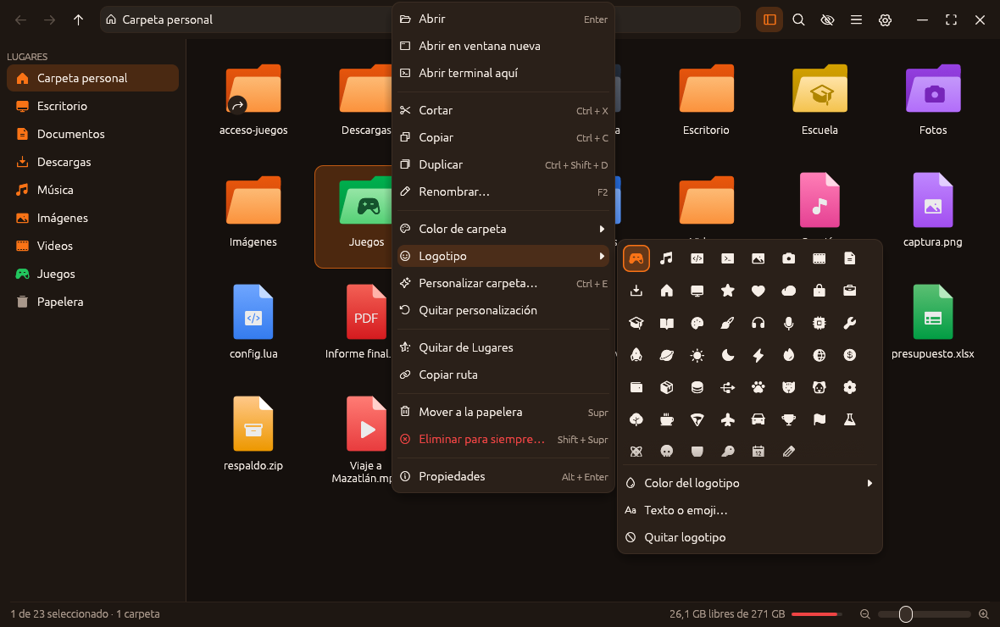<p align="center"><sub>Clic derecho → <b>Logotipo</b></sub></p></td>
</tr>
<tr>
<td>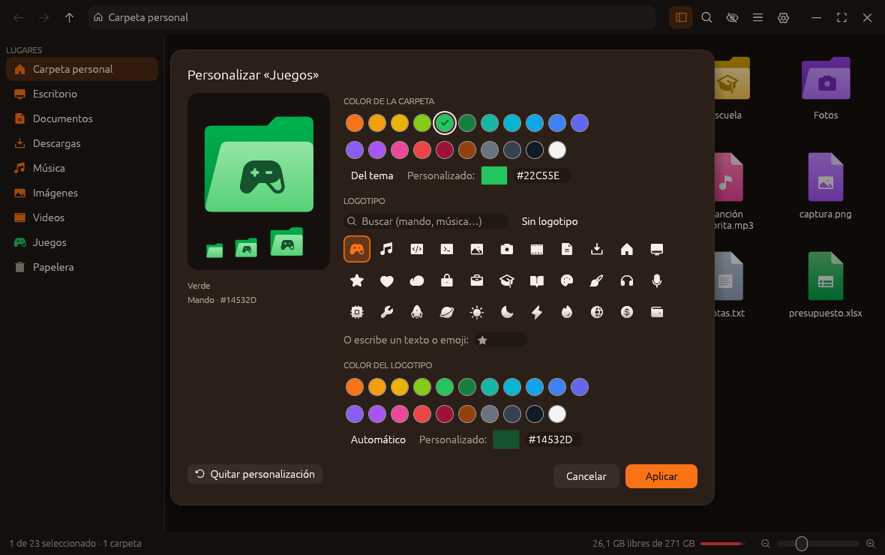<p align="center"><sub><b>Personalizar carpeta</b>: verde con un mando verde oscuro</sub></p></td>
<td>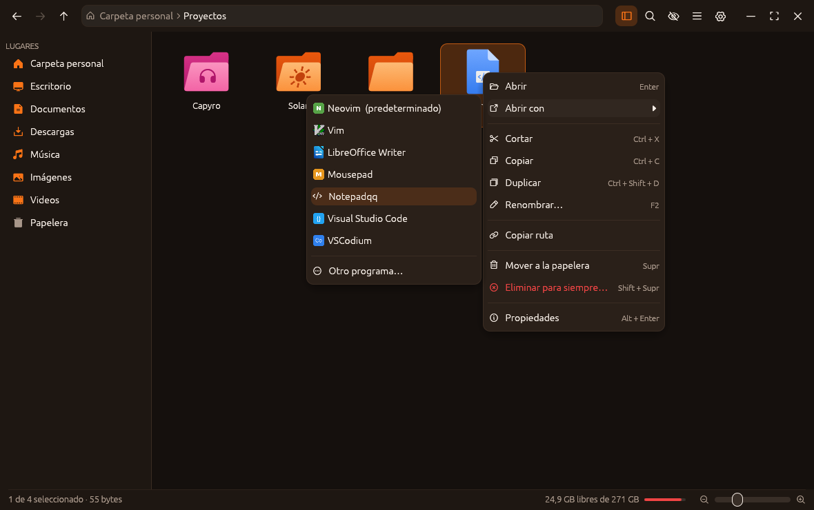<p align="center"><sub><b>Abrir con</b> en un <code>.cpp</code></sub></p></td>
</tr>
<tr>
<td>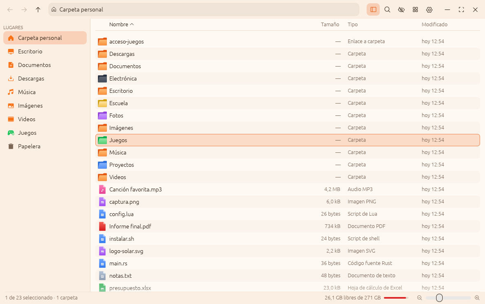<p align="center"><sub>Vista de lista con el tema claro <b>Aurora</b></sub></p></td>
<td>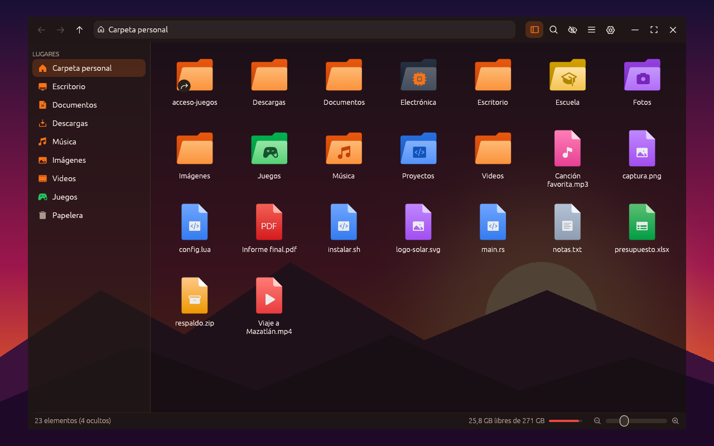<p align="center"><sub><b>Fondo transparente</b> al 75 % con un compositor</sub></p></td>
</tr>
<tr>
<td>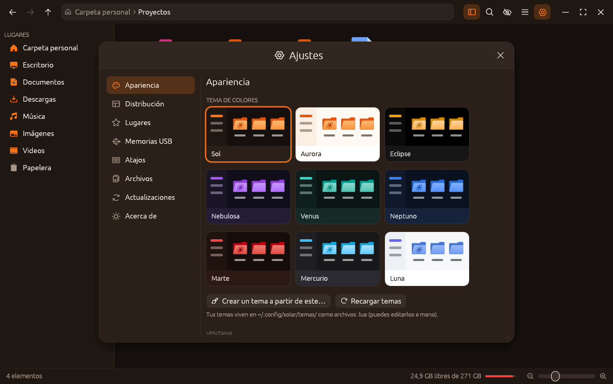<p align="center"><sub>Ajustes → <b>Temas</b></sub></p></td>
<td>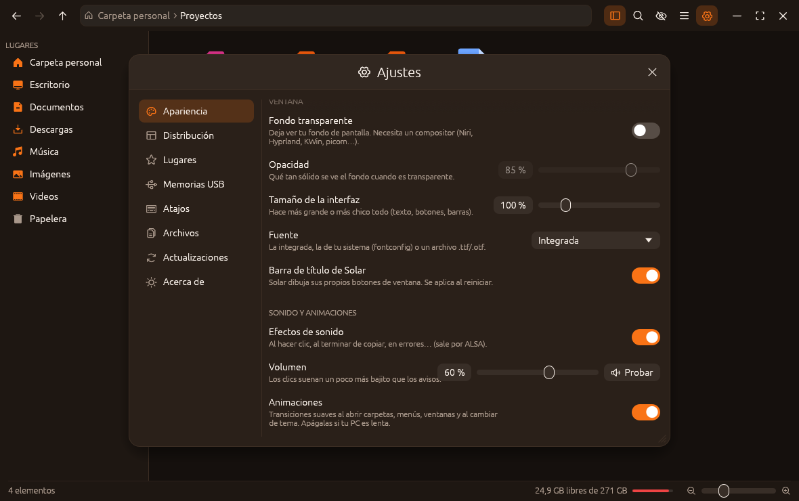<p align="center"><sub>Ajustes → <b>Ventana, sonido y animaciones</b></sub></p></td>
</tr>
<tr>
<td>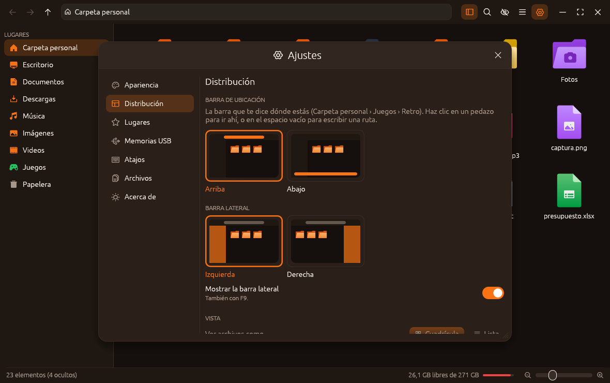<p align="center"><sub>Ajustes → <b>Distribución</b></sub></p></td>
<td>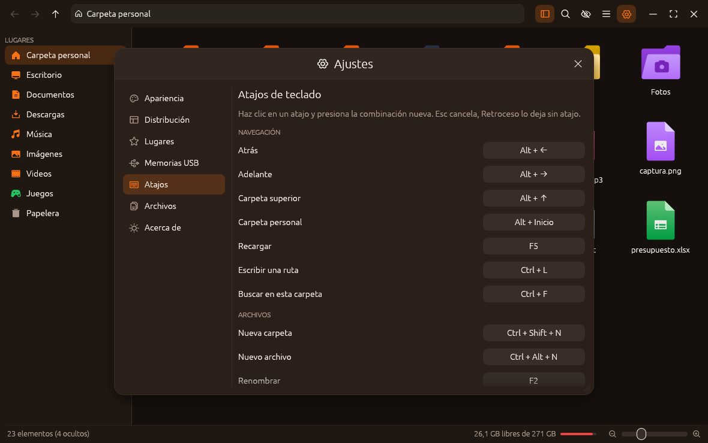<p align="center"><sub>Ajustes → <b>Atajos</b></sub></p></td>
</tr>
<tr>
<td>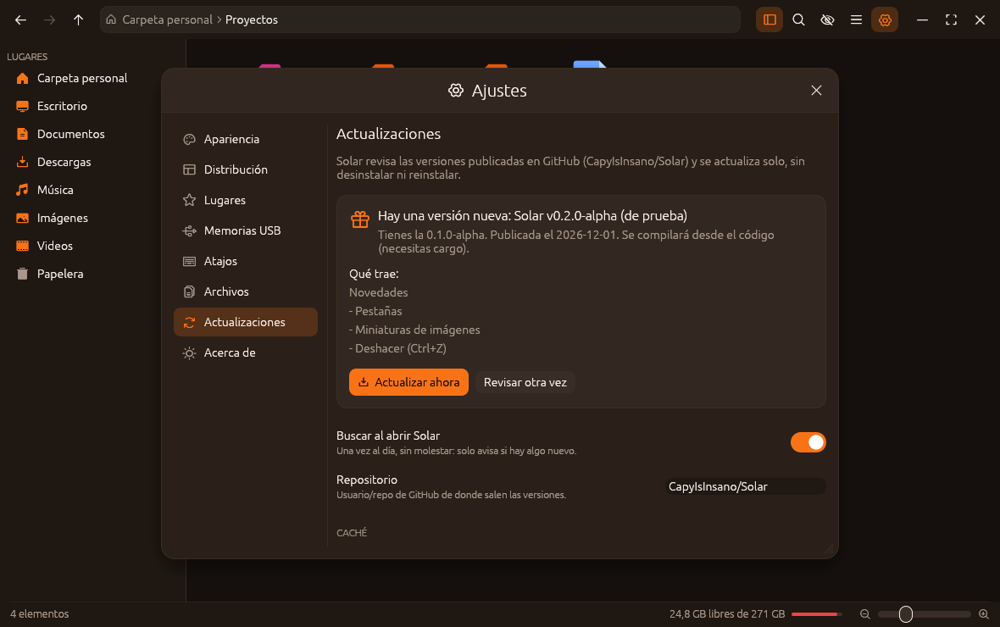<p align="center"><sub>Ajustes → <b>Actualizaciones</b></sub></p></td>
<td></td>
</tr>
</table>

<p align="right"><sub><a href="#inicio">↑ Subir</a></sub></p>


<a id="instalar"></a>

##  Instalar

<sub>⌂ Solar › <b>Instalar</b></sub>

Necesitas **Rust 1.95 o más nuevo**, un compilador de C (gcc o clang) y
`git`. Para usarlo al 100 %: **udisks2** (memorias USB sin root),
**shared-mime-info** (Abrir con), **curl** (actualizaciones), PipeWire,
PulseAudio o ALSA (sonidos) y una terminal. Usa OpenGL 3: Mesa sirve,
incluso en GPUs viejitas.

**1. Lo necesario según tu distro**

<details open>
<summary><b>Gentoo</b></summary>

```sh
sudo emerge --ask --noreplace virtual/rust dev-vcs/git sys-fs/udisks x11-misc/xdg-utils \
    net-misc/curl x11-misc/shared-mime-info
rustc --version     # tiene que decir 1.95 o más nuevo
```

`virtual/rust` se conforma con `dev-lang/rust` o con `dev-lang/rust-bin`
(el precompilado, mucho más rápido de instalar).
</details>

<details>
<summary><b>Arch / Manjaro / EndeavourOS</b></summary>

```sh
sudo pacman -S --needed rust base-devel git udisks2 xdg-utils curl
```
</details>

<details>
<summary><b>Debian / Ubuntu / Linux Mint</b> (el Rust de los repos suele ser viejo: usa rustup)</summary>

```sh
sudo apt install build-essential git curl udisks2 xdg-utils libgl1
curl --proto '=https' --tlsv1.2 -sSf https://sh.rustup.rs | sh
source "$HOME/.cargo/env"
```
</details>

<details>
<summary><b>Fedora</b></summary>

```sh
sudo dnf install rust cargo gcc git udisks2 xdg-utils curl
```
</details>

<details>
<summary><b>Otras</b> (Alpine, Void…)</summary>

Instala Rust (≥ 1.95), un compilador de C, git, udisks2, xdg-utils y curl
con tu gestor de paquetes. En musl todavía no está probado.
</details>

**2. Clona y compila**

```sh
git clone https://github.com/CapyIsInsano/Solar.git
cd Solar
make                      # = cargo build --release (la primera vez tarda unos minutos)
./target/release/solar    # pruébalo sin instalar
```

**3. Instala**

```sh
sudo make instalar                  # en /usr/local, para todos
make instalar PREFIX=~/.local       # o solo para ti (con ~/.local/bin en el PATH)
```

Instala el programa, el lanzador y el ícono, así que Solar aparece en tu menú
de aplicaciones y con su logo en el dock.

**4. Hazlo tu gestor de archivos** (opcional)

```sh
xdg-mime default solar.desktop inode/directory
```

<details>
<summary>¿Quieres usar el Lua de tu distro en vez del incluido?</summary>

```sh
cargo build --release --no-default-features --features lua-sistema
```

Busca `lua5.4`, `lua54` o `lua` con pkg-config (en Gentoo: `dev-lang/lua:5.4`).
</details>

<p align="right"><sub><a href="#inicio">↑ Subir</a></sub></p>


<a id="uso"></a>

##  Uso rápido

<sub>⌂ Solar › <b>Uso rápido</b></sub>

| Hacer | Cómo |
|---|---|
| Personalizar una carpeta | Clic derecho → <i>Color de carpeta</i> / <i>Logotipo</i>, o <kbd>Ctrl</kbd> + <kbd>E</kbd> |
| Abrir con otro programa | Clic derecho → <i>Abrir con</i> |
| Escribir una ruta | <kbd>Ctrl</kbd> + <kbd>L</kbd> o clic en el espacio vacío de la barra |
| Buscar en la carpeta | Empieza a escribir, o <kbd>Ctrl</kbd> + <kbd>F</kbd> |
| Ver ocultos | <kbd>Ctrl</kbd> + <kbd>H</kbd> |
| Cuadrícula / lista | <kbd>Ctrl</kbd> + <kbd>1</kbd> / <kbd>Ctrl</kbd> + <kbd>2</kbd> |
| Íconos más grandes o chicos | <kbd>Ctrl</kbd> + rueda, <kbd>Ctrl</kbd> + <kbd>Plus</kbd> / <kbd>Ctrl</kbd> + <kbd>Minus</kbd> |
| Nueva carpeta / archivo | <kbd>Ctrl</kbd> + <kbd>Shift</kbd> + <kbd>N</kbd> / <kbd>Ctrl</kbd> + <kbd>Alt</kbd> + <kbd>N</kbd> |
| Renombrar | <kbd>F2</kbd> |
| Papelera / eliminar para siempre | <kbd>Supr</kbd> / <kbd>Shift</kbd> + <kbd>Supr</kbd> |
| Copiar, cortar, pegar, duplicar | <kbd>Ctrl</kbd> + <kbd>C</kbd> <kbd>Ctrl</kbd> + <kbd>X</kbd> <kbd>Ctrl</kbd> + <kbd>V</kbd> <kbd>Ctrl</kbd> + <kbd>Shift</kbd> + <kbd>D</kbd> |
| Propiedades | <kbd>Alt</kbd> + <kbd>Enter</kbd> |
| Añadir a Lugares | <kbd>Ctrl</kbd> + <kbd>D</kbd> |
| Terminal aquí | <kbd>F4</kbd> |
| Barra lateral | <kbd>F9</kbd> |
| Ajustes | <kbd>Ctrl</kbd> + <kbd>,</kbd> |
| Atrás / adelante / subir | <kbd>Alt</kbd> + <kbd>←</kbd> <kbd>Alt</kbd> + <kbd>→</kbd> <kbd>Alt</kbd> + <kbd>↑</kbd> (o <kbd>Retroceso</kbd> y los botones del mouse) |
| Quitar la selección, cerrar menús o Ajustes | <kbd>Esc</kbd> |

Arrastra archivos sobre una carpeta, un lugar, una memoria USB o un pedazo de
la barra de ubicación para **moverlos**; con <kbd>Ctrl</kbd> se **copian**.
Suéltalos en *Papelera* para tirarlos. Al copiar, Solar también deja las
rutas como texto en el portapapeles: puedes pegarlas en una terminal.

<p align="right"><sub><a href="#inicio">↑ Subir</a></sub></p>


<a id="configuracion"></a>

##  Configuración

<sub>⌂ Solar › <b>Configuración</b></sub>

| | Archivo | Para qué |
|:-:|---|---|
|  | `~/.config/solar/config.lua` | Todos los ajustes. Solar lo crea la primera vez y lo reescribe cuando cambias algo en Ajustes. |
|  | `~/.config/solar/temas/` | Tus temas de colores (Solar nunca los reescribe). |
|  | `~/.local/share/solar/carpetas.tsv` | El color y logotipo de cada carpeta. |
|  | `~/.config/mimeapps.list` | El programa predeterminado de cada tipo de archivo (el mismo de los demás programas). |
|  | `~/.cache/solar/` | Descargas y compilaciones de actualizaciones. Se puede borrar sin miedo. |

`config.lua` es Lua de verdad, en un entorno seguro: sin `io`, `os.execute`
ni `require`, y con límite de memoria y de tiempo para que un bucle infinito
no congele Solar. Si algo no se entiende, Solar te dice qué fue y usa el valor
por defecto. Todas las opciones están explicadas en
[`config/config.lua`](config/config.lua).

```lua
return {
  tema = "nebulosa",
  transparencia = true,
  opacidad = 0.8,
  barra_ubicacion = "abajo",
  barra_lateral = "derecha",
  sonidos = true,
  atajos = { terminal = "Ctrl+T", eliminar = false },
}
```

<p align="right"><sub><a href="#inicio">↑ Subir</a></sub></p>


<a id="temas"></a>

##  Temas

<sub>⌂ Solar › <b>Temas</b></sub>

Crea un archivo en `~/.config/solar/temas/`, por ejemplo `bosque.lua`:

```lua
return {
  nombre = "Bosque",
  base = "venus",               -- hereda todo lo que no pongas
  colores = {
    acento  = "#22C55E",
    carpeta = "#15803D",        -- color de las carpetas sin personalizar
  },
}
```

Colores: `fondo`, `superficie`, `elevado`, `borde`, `texto`, `texto_tenue`,
`acento`, `texto_acento`, `seleccion`, `peligro`, `exito`, `aviso` y
`carpeta`. También puedes hacer uno desde *Ajustes → Apariencia → Crear un
tema a partir de este…*. Ejemplo completo en
[`config/temas/ejemplo.lua`](config/temas/ejemplo.lua).

<p align="right"><sub><a href="#inicio">↑ Subir</a></sub></p>


<a id="actualizar"></a>

##  Actualizar

<sub>⌂ Solar › <b>Actualizar</b></sub>

Desde Solar: *Ajustes → Actualizaciones → Buscar actualizaciones →
Actualizar ahora*, y luego *Reiniciar Solar*. No hay que desinstalar nada.
Solar compila la versión nueva con tu `cargo` (lo compilado se guarda en
`~/.cache/solar`, así que las siguientes son más rápidas). Si lo instalaste
con `sudo`, te pide la contraseña con pkexec. *Borrar caché* libera ese
espacio.

A mano también se puede: `git pull && make && sudo make instalar`.

**¿Cómo se entera Solar de que hay algo nuevo?**

- **Commits nuevos:** con solo hacer `git push` a `main`. Solar sabe de qué
  commit salió (`solar --version` lo muestra) y te ofrece *«Hay 3 commits
  nuevos en main»* con sus mensajes. Si lo compilaste con cambios tuyos que
  no están en GitHub, no te ofrece nada.
- **Versiones publicadas:**
  1. Sube la versión en `Cargo.toml` y en `nucleo/include/solar.h`, y
     escribe qué trae en `CHANGELOG.md`.
  2. `git commit -am "Solar v0.2.0-alpha" && git push`
  3. `git tag v0.2.0-alpha && git push origin v0.2.0-alpha`
  4. En GitHub → *Releases → Draft a new release*, elige esa etiqueta y pega
     las notas: Solar las muestra en *Qué trae*.

  Orden de versiones: `0.2.0-alpha < 0.2.0-beta < 0.2.0-rc1 < 0.2.0`.

<p align="right"><sub><a href="#inicio">↑ Subir</a></sub></p>


<a id="desinstalar"></a>

##  Desinstalar

<sub>⌂ Solar › <b>Desinstalar</b></sub>

Desde la carpeta del código (usa el mismo `PREFIX` con el que instalaste):

```sh
sudo make desinstalar               # o: make desinstalar PREFIX=~/.local
```

Eso quita el programa, el lanzador, los íconos y los ejemplos. **Tu
configuración se queda**, por si vuelves. Para borrar todo rastro:

```sh
rm -rf ~/.config/solar ~/.local/share/solar ~/.cache/solar
rm -f ~/.local/share/applications/solar.desktop \
      ~/.local/share/icons/hicolor/*/apps/solar.png \
      ~/.local/share/icons/hicolor/scalable/apps/solar.svg
```

<details>
<summary>¿Ya no tienes la carpeta del código?</summary>

```sh
sudo rm -f /usr/local/bin/solar /usr/local/share/applications/solar.desktop
sudo rm -f /usr/local/share/icons/hicolor/*/apps/solar.png \
           /usr/local/share/icons/hicolor/scalable/apps/solar.svg
sudo rm -rf /usr/local/share/solar
```
</details>

Si era tu gestor de archivos predeterminado, regresa al de antes, por ejemplo
`xdg-mime default thunar.desktop inode/directory`.

<p align="right"><sub><a href="#inicio">↑ Subir</a></sub></p>


<a id="como-esta-hecho"></a>

##  Cómo está hecho

<sub>⌂ Solar › <b>Cómo está hecho</b></sub>

| Parte | Lenguaje | Qué hace |
|---|---|---|
| `nucleo/` | **C11** | Listar y ordenar, copiar/mover/eliminar con progreso, papelera, memorias USB (sysfs + mountinfo + udisks2), vigilar cambios (inotify), colores y logotipos, tipos MIME y programas (Abrir con), sonidos (minimp3 + PulseAudio/PipeWire o ALSA), y la configuración con **Lua 5.4** embebido. |
| `src/` | **Rust** (egui) | Toda la interfaz y el dibujo vectorial de carpetas y archivos. Llama al núcleo por FFI. |
| `~/.config/solar/*.lua` | **Lua** | Tu configuración y tus temas. |

`cargo build` compila todo junto: `build.rs` compila el núcleo en C y Lua
(viene incluido) y los enlaza con la interfaz.

**Hecho para gastar poco** (pensando en laptops como la X220):

- Sin hacer nada, Solar no redibuja ni revisa nada: los cambios de carpetas,
  de la papelera, de montajes y de discos (`/dev`) llegan por eventos
  (inotify, mountinfo, eventfd). Lo único que despierta al programa es la
  biblioteca de accesibilidad, 2 veces por segundo.
- Leer, ordenar e indexar las carpetas se hace en otro hilo; soltar una
  carpeta enorme también, y la memoria se le devuelve al sistema.
- Lo que se dibuja en cada cuadro no copia nada: la barra de estado y el
  estilo se recalculan solo cuando cambian.
- Los sonidos se mezclan en un solo hilo con una sola conexión de audio, que
  se cierra tras 2 s de silencio.

**Así se ve la carpeta del proyecto:**

| | Nombre | Tipo | Qué hay |
|:-:|---|---|---|
|  | **`nucleo/`** | Carpeta | El núcleo en C: listado, copiar/mover, papelera, USB, MIME y programas, sonido, Lua |
|  | **`nucleo/include/solar.h`** | Encabezado C | La API pública del núcleo |
|  | **`nucleo/pruebas/`** | Carpeta | 218 revisiones con AddressSanitizer + UBSan |
|  | **`nucleo/terceros/minimp3/`** | Carpeta | Decodificador de MP3 (CC0) |
|  | **`src/`** | Carpeta | La interfaz en Rust (egui): ventana, vistas, menús, diálogos, Ajustes |
|  | **`src/app.rs`** | Código Rust | Estado, navegación y acciones |
|  | **`src/vista.rs`** | Código Rust | Cuadrícula, lista, selección y clic derecho |
|  | **`src/iconos.rs`** | Código Rust | Carpetas y archivos vectoriales con la forma del logo |
|  | **`src/actualizar.rs`** | Código Rust | Buscar en GitHub, compilar y reemplazar el programa |
|  | **`config/`** | Carpeta | Ejemplos de <code>config.lua</code> y de un tema |
|  | **`recursos/`** | Carpeta | Logo, íconos, sonidos y <code>solar.desktop</code> |
|  | **`docs/`** | Carpeta | Capturas y las imágenes de este README |
|  | **`build.rs`** | Código Rust | Compila el núcleo en C y Lua junto con la interfaz |
|  | **`Cargo.toml`** | TOML | Versión y dependencias de Rust |
|  | **`Makefile`** | Makefile | <code>make</code>, <code>make instalar</code>, <code>make pruebas</code> |
|  | **`CHANGELOG.md`** | Markdown | Qué trae cada versión |
|  | **`LICENSE`** | Texto | GPL-3.0 |

<p align="right"><sub><a href="#inicio">↑ Subir</a></sub></p>


<a id="pruebas"></a>

##  Pruebas

<sub>⌂ Solar › <b>Pruebas</b></sub>

```sh
make pruebas                 # pruebas de Rust (también ejercitan el núcleo)
make pruebas-nucleo          # núcleo en C con AddressSanitizer + UBSan
```

**Medir el rendimiento:** `SOLAR_PERFIL=1 solar` escribe en la terminal cuánto
tarda cada parte de la ventana por cuadro, el arranque, cada listado de
carpeta y cada revisión de discos. Apagado no cuesta nada.

**Limitaciones conocidas** (es una alpha):

- Solo Linux.
- Todavía no hay pestañas, miniaturas ni deshacer.
- Arrastrar *desde* Solar hacia otros programas no funciona aún; soltar *en*
  Solar funciona en X11, en Wayland todavía no.
- La transparencia necesita un compositor (Niri, Hyprland, KWin, picom…).
- Si `config.lua` tiene lógica (if, variables), Ajustes la convierte en
  valores fijos la próxima vez que cambies algo desde la ventana.

**Ideas para las siguientes versiones:** pestañas, miniaturas, deshacer,
búsqueda en subcarpetas, panel doble, comprimir/extraer y logotipos con
imágenes propias.

<p align="right"><sub><a href="#inicio">↑ Subir</a></sub></p>


<a id="licencia"></a>

##  Licencia

<sub>⌂ Solar › <b>Licencia</b></sub>

Solar es software libre bajo la **GPL-3.0 o posterior** ([LICENSE](LICENSE)):
puedes usarlo, estudiarlo, cambiarlo y compartirlo, y quien distribuya una
versión modificada tiene que compartir también su código bajo la misma
licencia.

<p align="right"><sub><a href="#inicio">↑ Subir</a></sub></p>


<a id="creditos"></a>

##  Créditos

<sub>⌂ Solar › <b>Créditos</b></sub>

Hecho por **Arturo ([CapyIsInsano](https://github.com/CapyIsInsano))**, el
mismo de [Capyro](https://github.com/CapyIsInsano/Capyro), de donde vienen
los efectos de sonido.

Usa [egui/eframe](https://github.com/emilk/egui) (MIT/Apache-2.0),
[Lua 5.4](https://www.lua.org) (MIT), íconos [Phosphor](https://phosphoricons.com)
(MIT), [minimp3](https://github.com/lieff/minimp3) (CC0) y
[resvg](https://github.com/linebender/resvg) (Apache-2.0/MIT). Las imágenes de
este README salen de [`docs/readme/generar.py`](docs/readme/generar.py).

<p align="center"><br><br><sub>☀ Solar · v0.1.1-alpha</sub></p>
